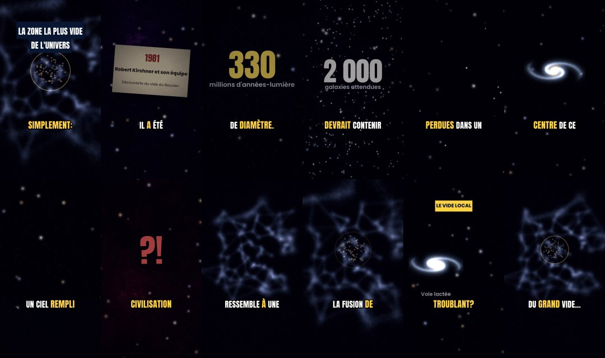

# Rapport de contrôle qualité

Généré automatiquement par `pipeline/qc.py` sur les fichiers finaux.

## video_03 — ⚠️ à vérifier

- ✅ fichier présent
- ✅ durée 65–115 s
- ✅ 1080×1920 (9:16)
- ✅ H.264 / yuv420p
- ✅ AAC 48 kHz stéréo
- ✅ décodage sans erreur
- ✅ loudness −15 à −13 LUFS
- ❌ true peak ≤ −0,5 dBTP
- ✅ sous-titres sur la voix (≥ 95 %)
- ✅ narration reconnue (Whisper ≥ 85 %)
- ✅ pas d'écran noir / image figée

Mesures : durée 83.4 s · -14.1 LUFS · true peak 0.0 dBTP · niveau parole -16.799999237060547 dBFS vs pauses -30.0 dBFS · 233 mots sous-titrés, 100.0 % tombent sur de la voix, 0 hors segment · reconnaissance Whisper : 92.0 % des mots du script · luminosité min 5.9 · variation moyenne entre images 16.4

Extrait de transcription automatique : « Il existe une zone de l'univers tellement vite qu'on la surnomme simplement le Grand Vide, son nom officiel, le vide du bouvier d'après la constellation dans laquelle on l'observe. Il a été découvert en 1981 et sa taille… »

