# Rapport de contrôle qualité

Généré automatiquement par `pipeline/qc.py` sur les fichiers finaux.

## video_01 — ✅ conforme

- ✅ fichier présent
- ✅ durée 65–115 s
- ✅ 1080×1920 (9:16)
- ✅ H.264 / yuv420p
- ✅ AAC 48 kHz stéréo
- ✅ décodage sans erreur
- ✅ loudness −15 à −13 LUFS
- ✅ true peak ≤ −0,5 dBTP
- ✅ sous-titres sur la voix (≥ 95 %)
- ✅ narration reconnue (Whisper ≥ 85 %)
- ✅ pas d'écran noir / image figée

Mesures : durée 86.3 s · -14.2 LUFS · true peak -1.4 dBTP · niveau parole -16.9 dBFS vs pauses -30.4 dBFS · 254 mots sous-titrés, 100.0 % tombent sur de la voix, 0 hors segment · reconnaissance Whisper : 86.4 % des mots du script (nombres exclus : Whisper les écrit en chiffres) · luminosité min 12.4 · variation moyenne entre images 65.5

Extrait de transcription automatique : « Il existe une planète où il pleut du verre. Et pas doucement, il tombe de côté à plus de 7000 km/h. Elle s'appelle HD-189-1733B. Elle se trouve à 64 années-lumière de nous, dans la constellation du petit renard. Vu de lo… »

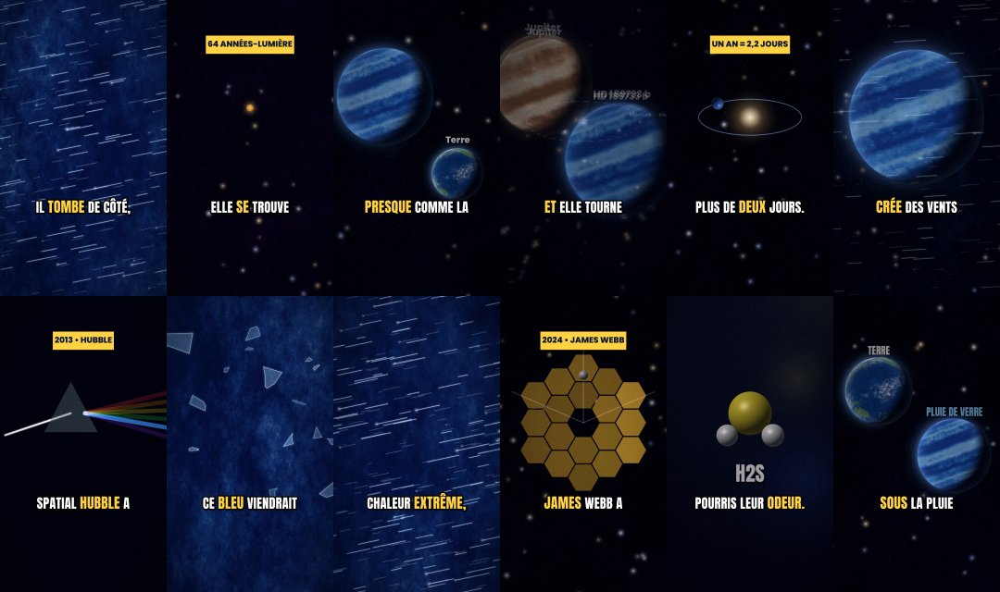

## video_02 — ✅ conforme

- ✅ fichier présent
- ✅ durée 65–115 s
- ✅ 1080×1920 (9:16)
- ✅ H.264 / yuv420p
- ✅ AAC 48 kHz stéréo
- ✅ décodage sans erreur
- ✅ loudness −15 à −13 LUFS
- ✅ true peak ≤ −0,5 dBTP
- ✅ sous-titres sur la voix (≥ 95 %)
- ✅ narration reconnue (Whisper ≥ 85 %)
- ✅ pas d'écran noir / image figée

Mesures : durée 95.7 s · -14.1 LUFS · true peak -1.1 dBTP · niveau parole -16.9 dBFS vs pauses -30.6 dBFS · 272 mots sous-titrés, 100.0 % tombent sur de la voix, 0 hors segment · reconnaissance Whisper : 86.7 % des mots du script (nombres exclus : Whisper les écrit en chiffres) · luminosité min 7.3 · variation moyenne entre images 45.5

Extrait de transcription automatique : « Si le soleil disparaissait maintenant, tu ne le saurais pas avant 8 minutes. Pendant 8 minutes et 20 secondes, tout continuera normalement. Le ciel resterait bleu, tu sentirais encore sa chaleur sur ta peau. Parce que la… »

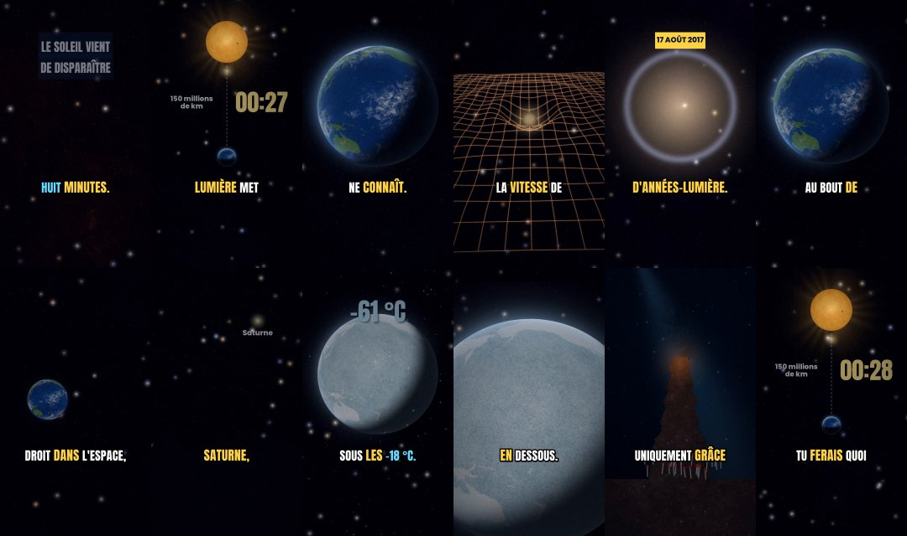

## video_03 — ✅ conforme

- ✅ fichier présent
- ✅ durée 65–115 s
- ✅ 1080×1920 (9:16)
- ✅ H.264 / yuv420p
- ✅ AAC 48 kHz stéréo
- ✅ décodage sans erreur
- ✅ loudness −15 à −13 LUFS
- ✅ true peak ≤ −0,5 dBTP
- ✅ sous-titres sur la voix (≥ 95 %)
- ✅ narration reconnue (Whisper ≥ 85 %)
- ✅ pas d'écran noir / image figée

Mesures : durée 83.4 s · -14.1 LUFS · true peak -0.8 dBTP · niveau parole -16.9 dBFS vs pauses -30.0 dBFS · 233 mots sous-titrés, 100.0 % tombent sur de la voix, 0 hors segment · reconnaissance Whisper : 92.7 % des mots du script (nombres exclus : Whisper les écrit en chiffres) · luminosité min 6.8 · variation moyenne entre images 32.9

Extrait de transcription automatique : « Il existe une zone de l'univers tellement vite qu'on la surnomme simplement le Grand Vide, son nom officiel, le vide du bouvier d'après la constellation dans laquelle on l'observe. Il a été découvert en 1981 et sa taille… »

## video_04 — ✅ conforme

- ✅ fichier présent
- ✅ durée 65–115 s
- ✅ 1080×1920 (9:16)
- ✅ H.264 / yuv420p
- ✅ AAC 48 kHz stéréo
- ✅ décodage sans erreur
- ✅ loudness −15 à −13 LUFS
- ✅ true peak ≤ −0,5 dBTP
- ✅ sous-titres sur la voix (≥ 95 %)
- ✅ narration reconnue (Whisper ≥ 85 %)
- ✅ pas d'écran noir / image figée

Mesures : durée 83.3 s · -14.1 LUFS · true peak -1.6 dBTP · niveau parole -16.9 dBFS vs pauses -30.7 dBFS · 257 mots sous-titrés, 100.0 % tombent sur de la voix, 0 hors segment · reconnaissance Whisper : 97.8 % des mots du script (nombres exclus : Whisper les écrit en chiffres) · luminosité min 6.9 · variation moyenne entre images 24.1

Extrait de transcription automatique : « Voici ce qui t'arriverait si tu tombais dans un trou noir. Et attention, tout dépend de sa taille. Prenons d'abord un petit trou noir d'environ 10 fois la masse du soleil. En t'approchant, la gravité tirerait beaucoup pl… »

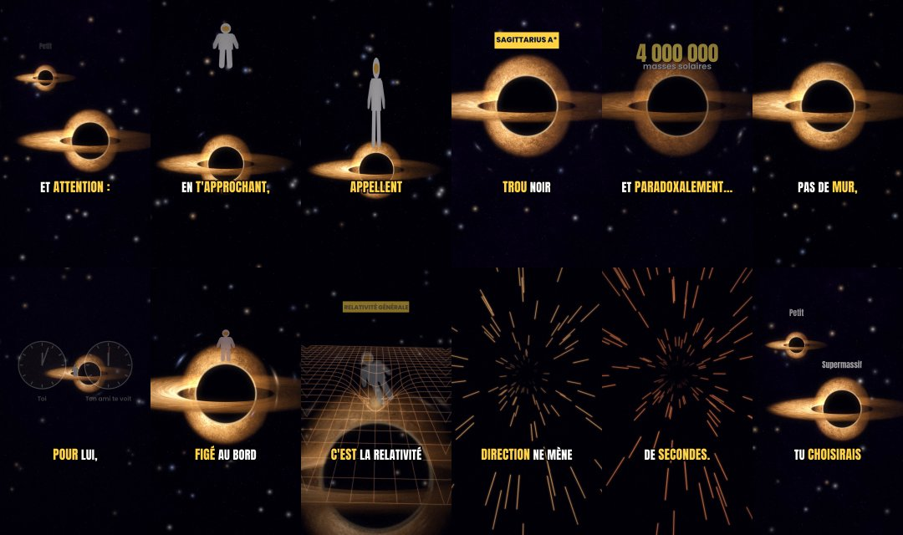

## video_05 — ✅ conforme

- ✅ fichier présent
- ✅ durée 65–115 s
- ✅ 1080×1920 (9:16)
- ✅ H.264 / yuv420p
- ✅ AAC 48 kHz stéréo
- ✅ décodage sans erreur
- ✅ loudness −15 à −13 LUFS
- ✅ true peak ≤ −0,5 dBTP
- ✅ sous-titres sur la voix (≥ 95 %)
- ✅ narration reconnue (Whisper ≥ 85 %)
- ✅ pas d'écran noir / image figée

Mesures : durée 85.9 s · -14.1 LUFS · true peak -1.0 dBTP · niveau parole -16.9 dBFS vs pauses -31.2 dBFS · 253 mots sous-titrés, 100.0 % tombent sur de la voix, 0 hors segment · reconnaissance Whisper : 98.0 % des mots du script (nombres exclus : Whisper les écrit en chiffres) · luminosité min 4.6 · variation moyenne entre images 38.9

Extrait de transcription automatique : « Sur Vénus, une journée dure plus longtemps qu'une année. Et ce n'est pas une image, c'est littéralement vrai. Vénus met 243 jours terrestres pour faire un tour sur elle-même. Mais seulement 225 jours pour faire le tour d… »

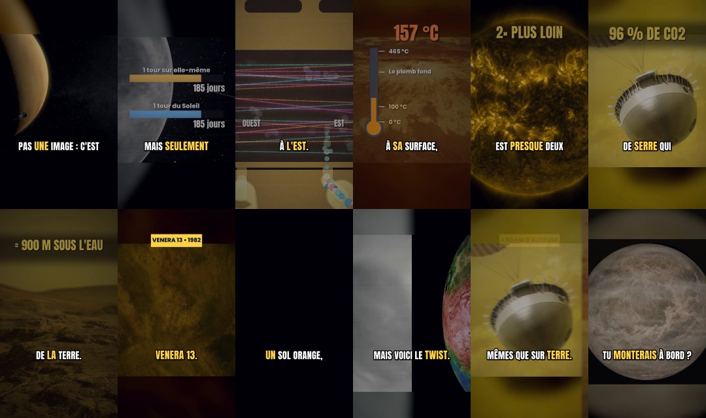

## video_06 — ✅ conforme

- ✅ fichier présent
- ✅ durée 65–115 s
- ✅ 1080×1920 (9:16)
- ✅ H.264 / yuv420p
- ✅ AAC 48 kHz stéréo
- ✅ décodage sans erreur
- ✅ loudness −15 à −13 LUFS
- ✅ true peak ≤ −0,5 dBTP
- ✅ sous-titres sur la voix (≥ 95 %)
- ✅ narration reconnue (Whisper ≥ 85 %)
- ✅ pas d'écran noir / image figée

Mesures : durée 98.5 s · -14.1 LUFS · true peak -0.7 dBTP · niveau parole -16.9 dBFS vs pauses -30.2 dBFS · 281 mots sous-titrés, 100.0 % tombent sur de la voix, 0 hors segment · reconnaissance Whisper : 93.8 % des mots du script (nombres exclus : Whisper les écrit en chiffres) · luminosité min 53.3 · variation moyenne entre images 36.6

Extrait de transcription automatique : « Voici ce que voient les astronautes quand un ouragan passe sous la station spatiale. On est à 400 km d'altitude et cet spirale de nuage fait plusieurs centaines de kilomètres de large. Celui-ci, c'est Buril, en juillet 2… »

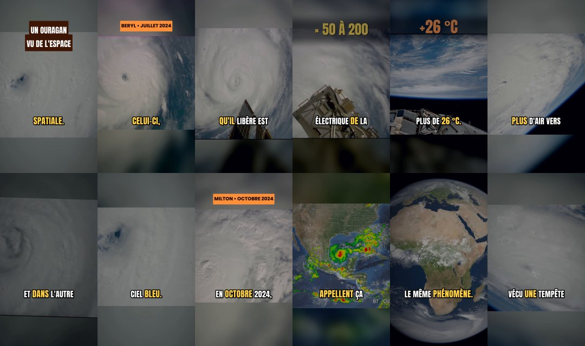

## video_07 — ✅ conforme

- ✅ fichier présent
- ✅ durée 65–115 s
- ✅ 1080×1920 (9:16)
- ✅ H.264 / yuv420p
- ✅ AAC 48 kHz stéréo
- ✅ décodage sans erreur
- ✅ loudness −15 à −13 LUFS
- ✅ true peak ≤ −0,5 dBTP
- ✅ sous-titres sur la voix (≥ 95 %)
- ✅ narration reconnue (Whisper ≥ 85 %)
- ✅ pas d'écran noir / image figée

Mesures : durée 87.8 s · -14.1 LUFS · true peak -0.9 dBTP · niveau parole -16.9 dBFS vs pauses -30.0 dBFS · 235 mots sous-titrés, 100.0 % tombent sur de la voix, 0 hors segment · reconnaissance Whisper : 91.9 % des mots du script (nombres exclus : Whisper les écrit en chiffres) · luminosité min 23.2 · variation moyenne entre images 46.6

Extrait de transcription automatique : « Le 15 janvier 2022, un volcan sous-marin a explosé avec une puissance jamais enregistrée par nos instruments modernes. Son nom, un gâton ginga H à lettre de bébé, API, dans le Pacifique Sud. Regarde ces images satellites… »

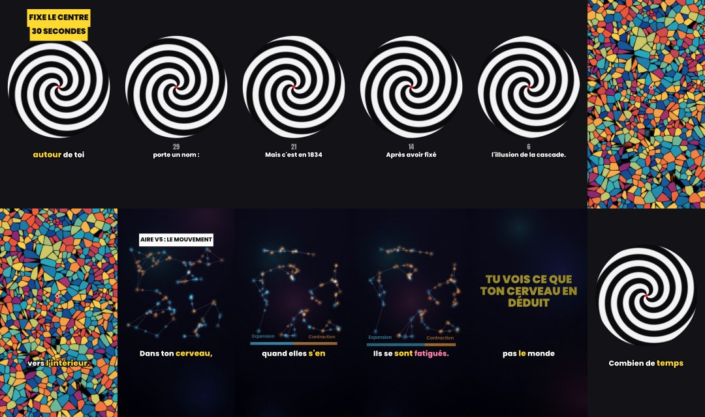

## video_08 — ✅ conforme

- ✅ fichier présent
- ✅ durée 65–115 s
- ✅ 1080×1920 (9:16)
- ✅ H.264 / yuv420p
- ✅ AAC 48 kHz stéréo
- ✅ décodage sans erreur
- ✅ loudness −15 à −13 LUFS
- ✅ true peak ≤ −0,5 dBTP
- ✅ sous-titres sur la voix (≥ 95 %)
- ✅ narration reconnue (Whisper ≥ 85 %)
- ✅ pas d'écran noir / image figée

Mesures : durée 79.9 s · -14.1 LUFS · true peak -1.6 dBTP · niveau parole -16.8 dBFS vs pauses -30.0 dBFS · 223 mots sous-titrés, 100.0 % tombent sur de la voix, 0 hors segment · reconnaissance Whisper : 93.2 % des mots du script (nombres exclus : Whisper les écrit en chiffres) · luminosité min 6.4 · variation moyenne entre images 37.0

Extrait de transcription automatique : « Ce n'est une flash fleur rouge au-dessus des nuages, ce n'est pas un effet spécial. Il a été filmé depuis la station spatiale. Ça s'appelle un Sprit et pendant longtemps presque personne n'y croyait. Les pilotes de ligne… »

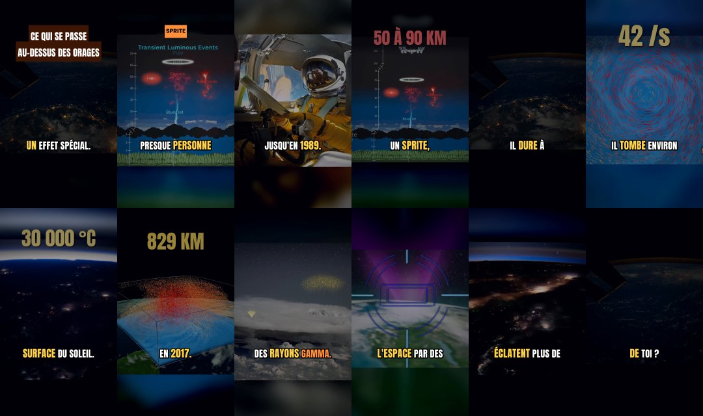

## video_09 — ✅ conforme

- ✅ fichier présent
- ✅ durée 65–115 s
- ✅ 1080×1920 (9:16)
- ✅ H.264 / yuv420p
- ✅ AAC 48 kHz stéréo
- ✅ décodage sans erreur
- ✅ loudness −15 à −13 LUFS
- ✅ true peak ≤ −0,5 dBTP
- ✅ sous-titres sur la voix (≥ 95 %)
- ✅ narration reconnue (Whisper ≥ 85 %)
- ✅ pas d'écran noir / image figée

Mesures : durée 76.0 s · -14.1 LUFS · true peak -0.6 dBTP · niveau parole -16.9 dBFS vs pauses -30.0 dBFS · 216 mots sous-titrés, 100.0 % tombent sur de la voix, 0 hors segment · reconnaissance Whisper : 88.6 % des mots du script (nombres exclus : Whisper les écrit en chiffres) · luminosité min 8.1 · variation moyenne entre images 29.6

Extrait de transcription automatique : « Voici des aurores boréales vues d'en haut depuis la station spatiale. Pour les astronautes, ce rideau de lumière on dule juste sous leurs pieds. Mais d'où vient cette lumière ? Tout commence sur le soleil à 150 millions … »

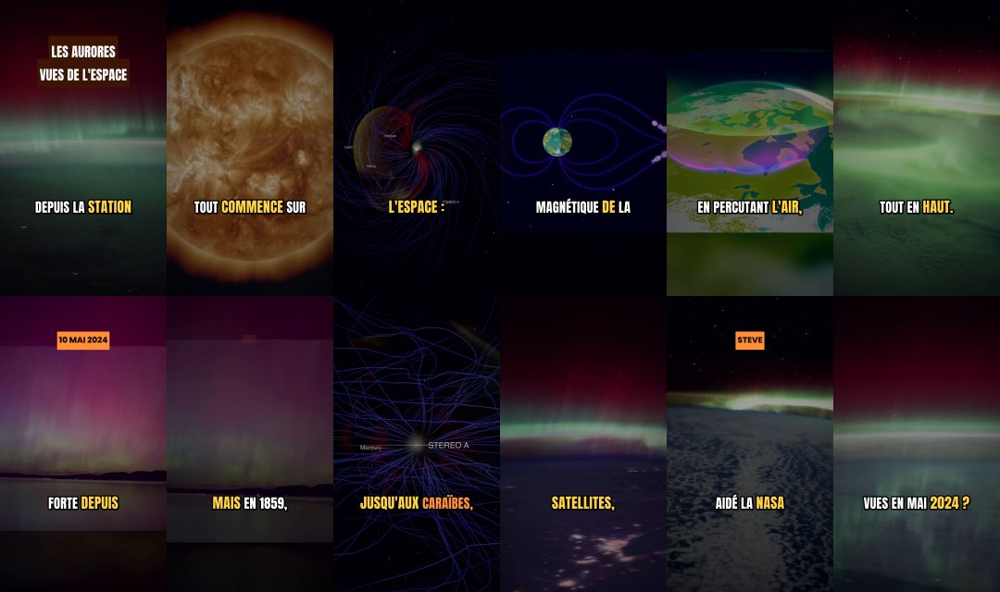

## video_10 — ✅ conforme

- ✅ fichier présent
- ✅ durée 65–115 s
- ✅ 1080×1920 (9:16)
- ✅ H.264 / yuv420p
- ✅ AAC 48 kHz stéréo
- ✅ décodage sans erreur
- ✅ loudness −15 à −13 LUFS
- ✅ true peak ≤ −0,5 dBTP
- ✅ sous-titres sur la voix (≥ 95 %)
- ✅ narration reconnue (Whisper ≥ 85 %)
- ✅ pas d'écran noir / image figée

Mesures : durée 78.2 s · -14.1 LUFS · true peak -1.6 dBTP · niveau parole -16.9 dBFS vs pauses -30.5 dBFS · 233 mots sous-titrés, 100.0 % tombent sur de la voix, 0 hors segment · reconnaissance Whisper : 96.3 % des mots du script (nombres exclus : Whisper les écrit en chiffres) · luminosité min 23.1 · variation moyenne entre images 34.4

Extrait de transcription automatique : « Chaque année, le plus grand désert chaud du monde nourrit la plus grande forêt tropicale du monde. Et ce n'est pas une image, c'est une découverte des satellites de la NASA. Regarde ces nuages d'oranges, c'est de la pous… »

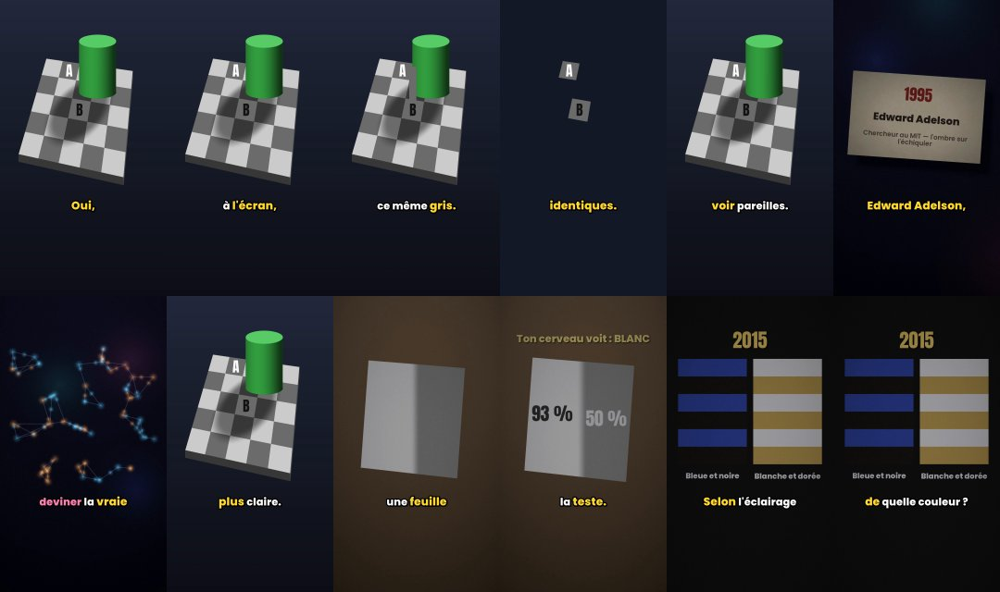

## video_11 — ✅ conforme

- ✅ fichier présent
- ✅ durée 65–115 s
- ✅ 1080×1920 (9:16)
- ✅ H.264 / yuv420p
- ✅ AAC 48 kHz stéréo
- ✅ décodage sans erreur
- ✅ loudness −15 à −13 LUFS
- ✅ true peak ≤ −0,5 dBTP
- ✅ sous-titres sur la voix (≥ 95 %)
- ✅ narration reconnue (Whisper ≥ 85 %)
- ✅ pas d'écran noir / image figée

Mesures : durée 76.8 s · -14.1 LUFS · true peak -1.6 dBTP · niveau parole -16.9 dBFS vs pauses -30.6 dBFS · 237 mots sous-titrés, 100.0 % tombent sur de la voix, 0 hors segment · reconnaissance Whisper : 94.3 % des mots du script (nombres exclus : Whisper les écrit en chiffres) · luminosité min 28.0 · variation moyenne entre images 55.4

Extrait de transcription automatique : « Une petite cuillère de cet étoile pèserait environ un milliard de tonnes. Bienvenue sur une étoile à neutrons, ce qui reste d'une étoile géante après sa mort. Tout commence avec une étoile bien plus massive que le soleil… »

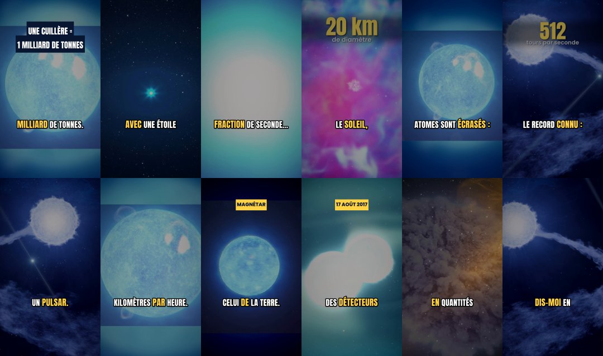

## video_12 — ✅ conforme

- ✅ fichier présent
- ✅ durée 65–115 s
- ✅ 1080×1920 (9:16)
- ✅ H.264 / yuv420p
- ✅ AAC 48 kHz stéréo
- ✅ décodage sans erreur
- ✅ loudness −15 à −13 LUFS
- ✅ true peak ≤ −0,5 dBTP
- ✅ sous-titres sur la voix (≥ 95 %)
- ✅ narration reconnue (Whisper ≥ 85 %)
- ✅ pas d'écran noir / image figée

Mesures : durée 81.5 s · -14.1 LUFS · true peak -1.4 dBTP · niveau parole -16.9 dBFS vs pauses -30.3 dBFS · 255 mots sous-titrés, 100.0 % tombent sur de la voix, 0 hors segment · reconnaissance Whisper : 96.0 % des mots du script (nombres exclus : Whisper les écrit en chiffres) · luminosité min 13.0 · variation moyenne entre images 44.4

Extrait de transcription automatique : « Chaque année, la Lune s'éloigne un peu plus de nous. De combien ? Environ 3,8 cm par an. À peu près la vitesse à laquelle poussent tes ongles. Et ce sont les missions Apollo qui nous permettent de le mesurer. En 1969, le… »

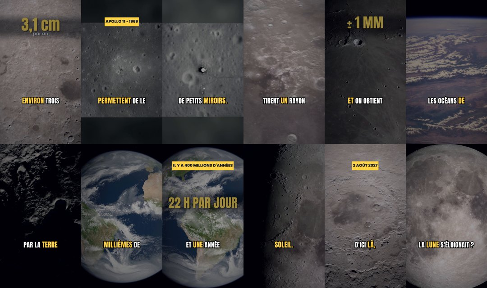

## video_13 — ✅ conforme

- ✅ fichier présent
- ✅ durée 65–115 s
- ✅ 1080×1920 (9:16)
- ✅ H.264 / yuv420p
- ✅ AAC 48 kHz stéréo
- ✅ décodage sans erreur
- ✅ loudness −15 à −13 LUFS
- ✅ true peak ≤ −0,5 dBTP
- ✅ sous-titres sur la voix (≥ 95 %)
- ✅ narration reconnue (Whisper ≥ 85 %)
- ✅ pas d'écran noir / image figée

Mesures : durée 78.4 s · -14.1 LUFS · true peak -1.1 dBTP · niveau parole -16.9 dBFS vs pauses -30.3 dBFS · 244 mots sous-titrés, 100.0 % tombent sur de la voix, 0 hors segment · reconnaissance Whisper : 89.7 % des mots du script (nombres exclus : Whisper les écrit en chiffres) · luminosité min 33.7 · variation moyenne entre images 32.5

Extrait de transcription automatique : « Sur Mars, il existe un volcan si grand qu'au sommet, tu aurais du mal à voir que tu es sur une montagne. Il s'appelle Olympiumon, c'est le plus grand volcan connu du système solaire. Il s'élève à plus de 20 km au-dessus … »

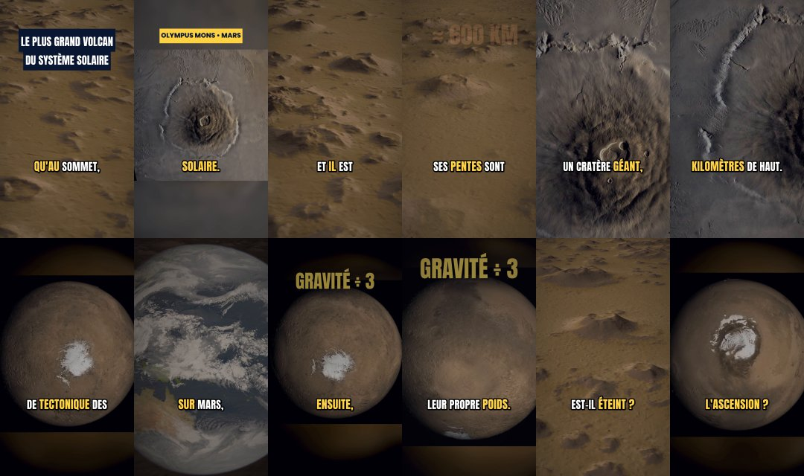

## video_14 — ✅ conforme

- ✅ fichier présent
- ✅ durée 65–115 s
- ✅ 1080×1920 (9:16)
- ✅ H.264 / yuv420p
- ✅ AAC 48 kHz stéréo
- ✅ décodage sans erreur
- ✅ loudness −15 à −13 LUFS
- ✅ true peak ≤ −0,5 dBTP
- ✅ sous-titres sur la voix (≥ 95 %)
- ✅ narration reconnue (Whisper ≥ 85 %)
- ✅ pas d'écran noir / image figée

Mesures : durée 68.3 s · -14.1 LUFS · true peak -1.1 dBTP · niveau parole -16.9 dBFS vs pauses -30.6 dBFS · 204 mots sous-titrés, 100.0 % tombent sur de la voix, 0 hors segment · reconnaissance Whisper : 91.4 % des mots du script (nombres exclus : Whisper les écrit en chiffres) · luminosité min 9.4 · variation moyenne entre images 38.8

Extrait de transcription automatique : « Il existe une tempête plus grande que la Terre et elle souffle depuis au moins 150 ans. Elle s'appelle la Grande Tâche Rouge et elle tourbillonne sur Jupiter. Jupiter est la plus grande planète du système solaire, on pou… »

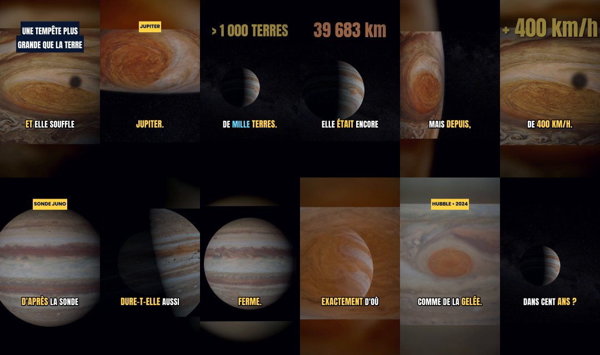

## video_15 — ✅ conforme

- ✅ fichier présent
- ✅ durée 65–115 s
- ✅ 1080×1920 (9:16)
- ✅ H.264 / yuv420p
- ✅ AAC 48 kHz stéréo
- ✅ décodage sans erreur
- ✅ loudness −15 à −13 LUFS
- ✅ true peak ≤ −0,5 dBTP
- ✅ sous-titres sur la voix (≥ 95 %)
- ✅ narration reconnue (Whisper ≥ 85 %)
- ✅ pas d'écran noir / image figée

Mesures : durée 72.6 s · -14.1 LUFS · true peak -1.2 dBTP · niveau parole -16.9 dBFS vs pauses -30.5 dBFS · 229 mots sous-titrés, 99.6 % tombent sur de la voix, 0 hors segment · reconnaissance Whisper : 96.9 % des mots du script (nombres exclus : Whisper les écrit en chiffres) · luminosité min 30.9 · variation moyenne entre images 46.8

Extrait de transcription automatique : « La lumière qui te réchauffe aujourd'hui a commencé son voyage il y a peut-être plus de 100 000 ans. Elle nette au cœur du soleil à environ 15 millions de degrés. Là, chaque seconde, le soleil fusionne environ 600 million… »

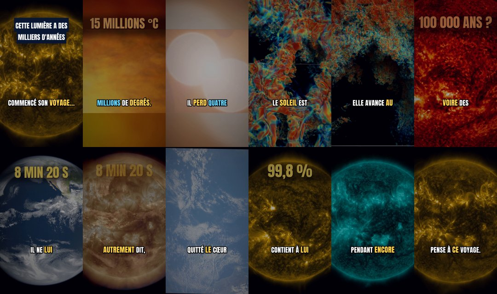

